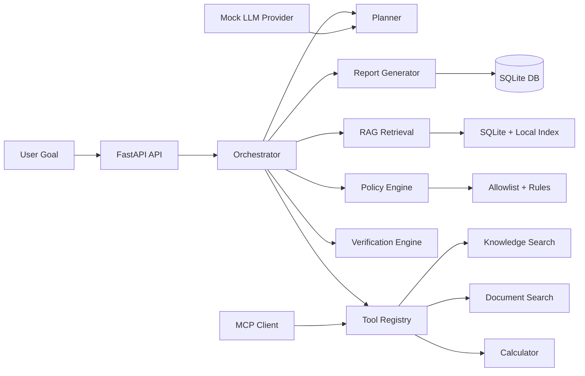

# AgentForge AI

AgentForge AI is a local AI agent orchestration platform that turns a user goal into a validated plan, uses retrieval-augmented generation to ground answers in local evidence, and records each tool call, verification result, and final report for auditability.

## Problem statement

Teams need AI systems that are traceable, constrained, and safe. Many agent prototypes are impressive in demos but fail in production because they lack plan validation, policy enforcement, tool guards, evidence tracking, and persistent execution history.

## Why this project matters

AgentForge AI demonstrates a production-minded pattern for AI automation:

- deterministic planning with dependency validation,
- policy-controlled tool execution,
- grounded evidence retrieval from local knowledge,
- structured verification before reporting,
- persistent run and report storage for later review.

## Key features

- FastAPI REST API with OpenAPI generation
- Structured planner with dependency checks and cycle detection
- Policy-based tool authorization and argument validation
- Safe calculator and local knowledge tools
- Retrieval index with local chunking and similarity search
- Mock LLM provider for deterministic offline execution
- Simple SQLAlchemy-backed SQLite persistence
- Verification engine and Markdown/JSON reporting
- Local MCP-compatible client adapter for mock server workflows

## Architecture diagram



## End-to-end pipeline

1. The user posts a goal to the API.
2. The orchestrator creates a run record and correlation ID.
3. The planner converts the objective into a dependency-ordered execution plan.
4. The policy engine validates the allowed tool set and arguments.
5. The executor runs approved tasks in dependency order.
6. The retrieval layer queries local evidence and returns grounded chunks.
7. Verification checks confirm the evidence and output contracts.
8. The reporting engine writes a Markdown and JSON final report.
9. Results remain available through the API and local SQLite persistence.

## Technology stack

- Python 3.12+
- FastAPI
- Pydantic
- SQLAlchemy
- SQLite
- pytest
- scikit-learn (modular ranking/ML component support)
- MCP SDK integration layer

## Repository structure

```text
agentforge-ai/
├── app/
│   ├── api/
│   │   └── routes/
│   ├── core/
│   ├── db/
│   ├── llm/
│   ├── mcp/
│   ├── policies/
│   ├── rag/
│   ├── reporting/
│   ├── schemas/
│   ├── tools/
│   ├── __init__.py
│   ├── main.py
│   ├── orchestrator.py
│   ├── planner.py
│   └── state_machine.py
├── tests/
├── .env.example
├── .gitignore
├── compose.yaml
├── Dockerfile
├── pyproject.toml
├── README.md
└── data/
```

## Prerequisites

- Python 3.12 or newer
- pip
- Git
- Optional: Docker and Docker Compose

## Installation

### Unix-like systems

```bash
cd AGENTFORGE-AI
python3 -m venv .venv
source .venv/bin/activate
python -m pip install --upgrade pip
python -m pip install -e .
```

### Windows PowerShell

```powershell
cd AGENTFORGE-AI
python -m venv .venv
.\.venv\Scripts\Activate.ps1
python -m pip install --upgrade pip
python -m pip install -e .
```

## Environment configuration

Copy the sample environment file and adjust values if needed:

```bash
cp .env.example .env
```

The default configuration expects a local SQLite database:

```env
DATABASE_URL=sqlite:///./data/agentforge.db
API_PREFIX=/api/v1
REQUEST_TIMEOUT_SECONDS=15
DEFAULT_TASK_LIMIT=5
DEFAULT_TOOL_LIMIT=10
```

## Database initialization

The application creates SQLite tables automatically on startup via SQLAlchemy metadata. The database file is stored under the `data` directory.

```bash
mkdir -p data
```

## Run the application

```bash
uvicorn app.main:app --reload --host 0.0.0.0 --port 8000
```

Check health:

```bash
curl http://localhost:8000/health
```

Example successful response:

```json
{"status": "ok", "service": "AgentForge AI"}
```

## Sample agent task

```bash
curl -X POST http://localhost:8000/api/v1/runs \
  -H "Content-Type: application/json" \
  -d '{"goal": "Assess launch readiness using local evidence.", "tool_names": ["calculator", "knowledge_search"]}'
```

## Ingest and query a document through RAG

```bash
curl -X POST http://localhost:8000/api/v1/knowledge/documents \
  -H "Content-Type: application/json" \
  -d '{"name": "launch.md", "content": "The launch is approved after QA sign-off and release checks."}'
```

Then query the knowledge index:

```bash
curl -X POST http://localhost:8000/api/v1/knowledge/search \
  -H "Content-Type: application/json" \
  -d '{"query": "QA sign-off"}'
```

Sample response:

```json
{
  "hits": [
    {
      "document_id": "doc-1",
      "source_name": "launch.md",
      "chunk_id": "doc-1-chunk-0",
      "text": "The launch is approved after QA sign-off and release checks.",
      "score": 0.8
    }
  ]
}
```

## LLM provider configuration

The local version uses the built-in mock provider by default for offline testing. To switch to a real provider later, configure the environment and adapt the provider adapter under `app/llm`.

```env
LLM_PROVIDER=mock
```

## MCP configuration

The project includes a local mock MCP adapter and a standard `MCPClient` wrapper. To configure a trusted external server, point the client to an approved MCP endpoint and maintain a strict allowlist of tool names.

- never expose credentials through logs,
- do not trust all discovered MCP tools,
- validate arguments and permissions before invocation,
- keep any server behind a trusted internal network.

## Run tests

```bash
pytest -q
```

## API endpoint reference

- GET `/health`
- GET `/ready`
- POST `/api/v1/runs`
- GET `/api/v1/runs/{run_id}`
- GET `/api/v1/runs/{run_id}/plan`
- GET `/api/v1/runs/{run_id}/events`
- GET `/api/v1/runs/{run_id}/report`
- POST `/api/v1/knowledge/documents`
- POST `/api/v1/knowledge/search`
- GET `/api/v1/tools`
- POST `/api/v1/runs/{run_id}/approve`
- POST `/api/v1/runs/{run_id}/cancel`

## Example requests and responses

### Create run

```bash
curl -X POST http://localhost:8000/api/v1/runs \
  -H "Content-Type: application/json" \
  -d '{"goal": "Assess launch readiness using local evidence.", "tool_names": ["calculator", "knowledge_search"]}'
```

```json
{"run_id": "run-3f1f0e67", "correlation_id": "corr-7d2d4d70", "status": "PENDING"}
```

### Get plan

```bash
curl http://localhost:8000/api/v1/runs/run-3f1f0e67/plan
```

```json
{
  "plan_id": "plan-7a5f0c1d",
  "goal": "Assess launch readiness using local evidence.",
  "tasks": [
    {"task_id": "t1", "description": "Gather relevant evidence ...", "dependencies": []},
    {"task_id": "t2", "description": "Perform quantitative analysis ...", "dependencies": ["t1"]}
  ],
  "estimated_task_count": 3
}
```

## Security considerations

- tool execution is restricted to an allowlist,
- arguments are sanitized and validated,
- shell and Python execution are not permitted through generated plans,
- local file access is restricted to safe search paths,
- retrieved content is treated as untrusted,
- human approval is required for sensitive actions in the approval flow,
- no secrets are committed to source control.

## Known limitations

- this is a local-first prototype and not a public deployment architecture,
- the document ingestion pipeline supports plain text and Markdown for the initial release,
- the mock LLM provider is intentionally deterministic rather than a production model adapter,
- source citations are grounded in local retrieved chunks, not external web verification,
- the system intentionally avoids unbounded autonomous execution.

## Roadmap

- replace the mock provider with real provider adapters,
- add richer MCP allowlist and authentication settings,
- improve retrieval ranking with scikit-learn features,
- add an optional UX dashboard,
- add more granular approval policies.

## Contributing

1. Create a feature branch.
2. Write or update a failing test for the behavior you plan to change.
3. Implement the fix.
4. Run the focused test suite.
5. Submit a pull request with the summary and evidence.

## License

This project is licensed under the MIT License.

```text
MIT License

Copyright (c) 2026

Permission is hereby granted, free of charge, to any person obtaining a copy
of this software and associated documentation files (the "Software"), to deal
in the Software without restriction, including without limitation the rights
to use, copy, modify, merge, publish, distribute, sublicense, and/or sell
copies of the Software, and to permit persons to whom the Software is
furnished to do so, subject to the following conditions:

The above copyright notice and this permission notice shall be included in all
copies or substantial portions of the Software.
```
